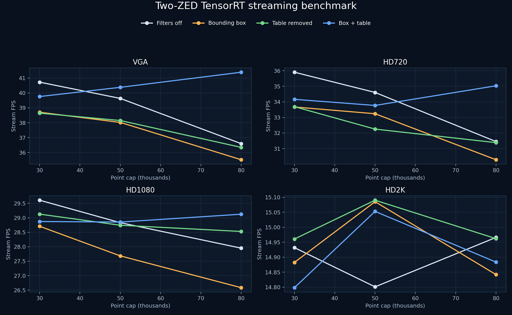
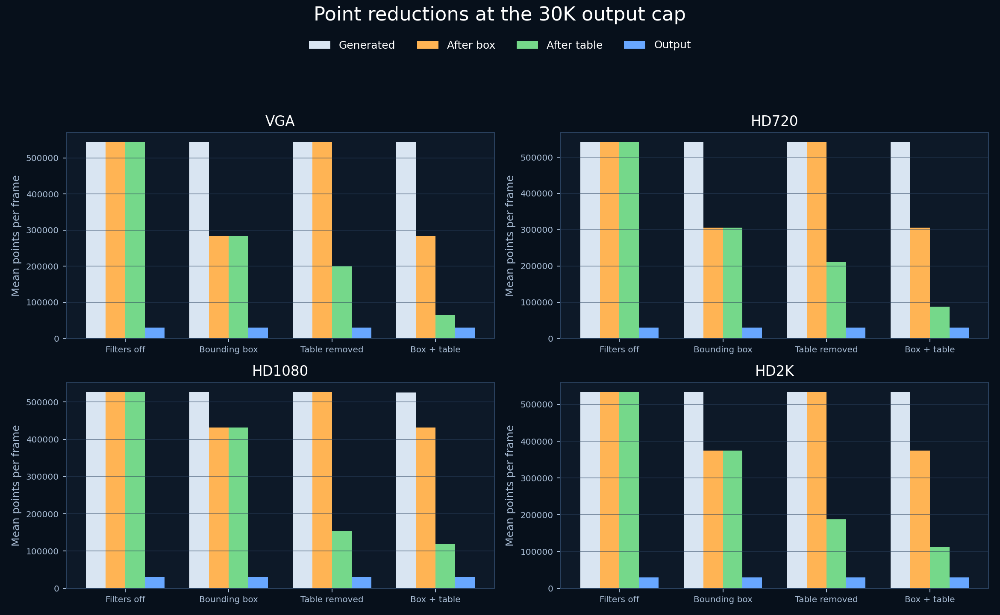
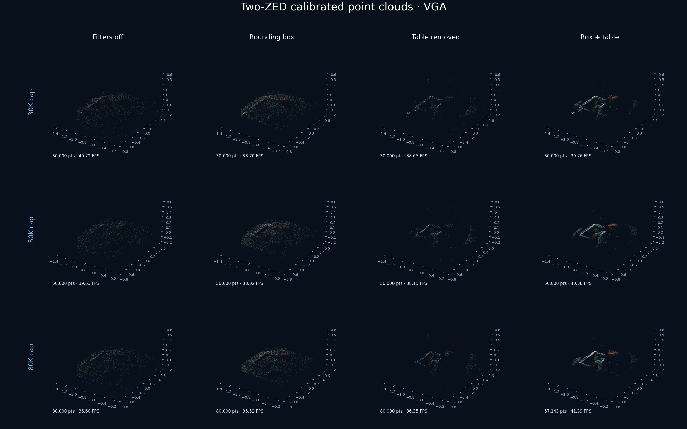
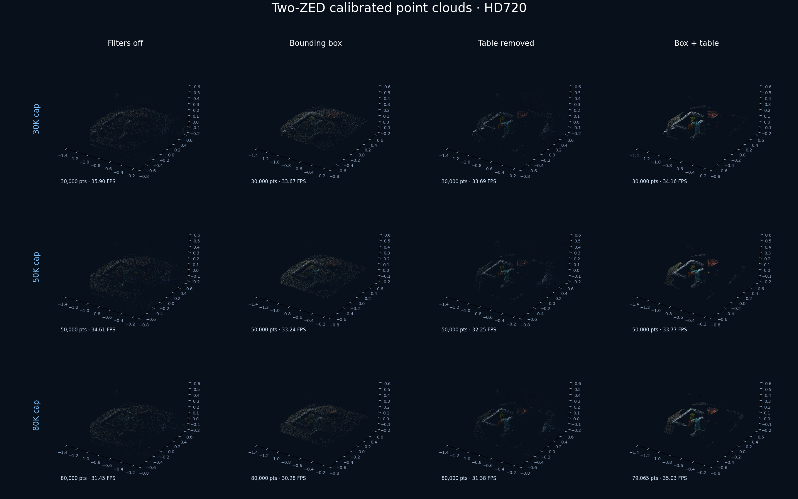
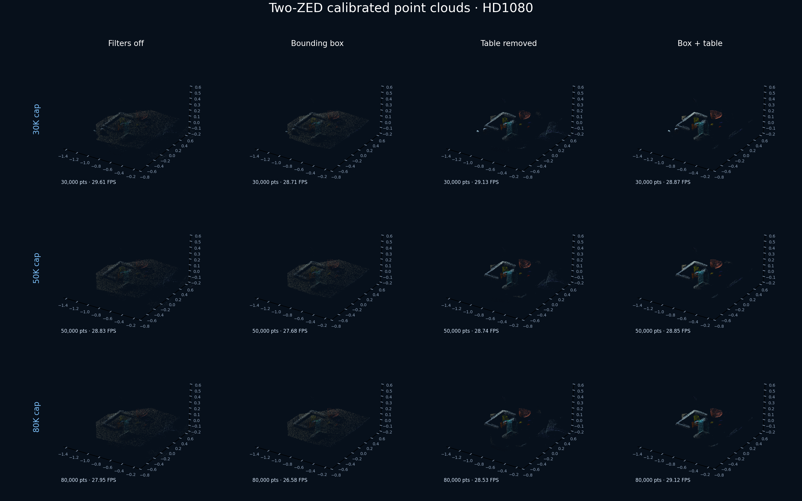
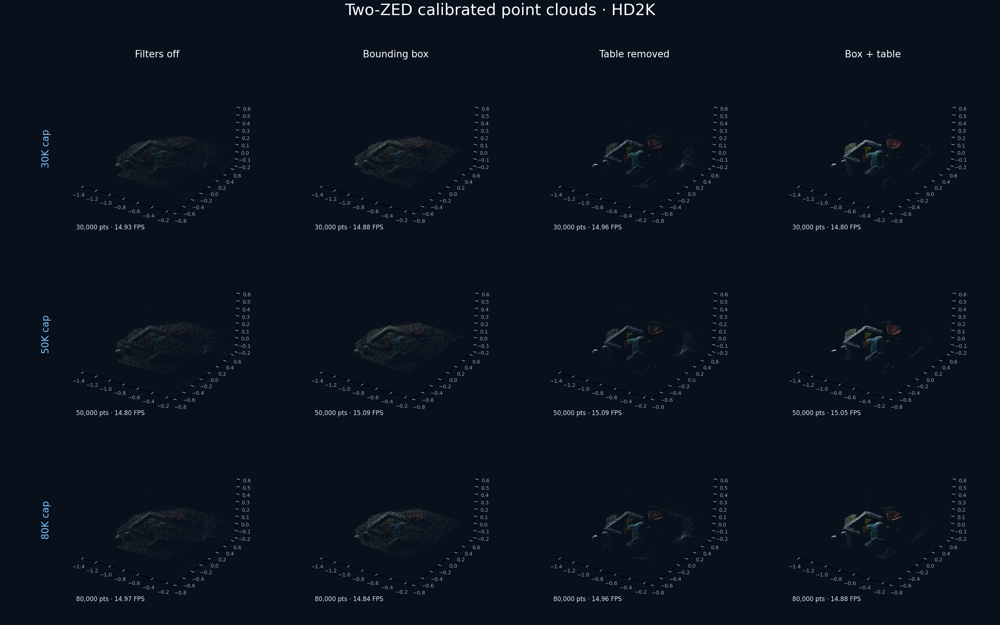

# Two-ZED spatial-filter benchmark and point-cloud gallery

[Open the interactive 3D gallery](https://raw.githack.com/EnesUlasDincer/FFS_stream/zed-trt-pointcloud-streaming/streamer/filter_benchmark_gallery/index.html)

For current one- and two-camera commands with CUDA Radius Outlier Removal, see
the [Fast Radius Outlier Removal section](../README_zed_foundation_streaming.md#fast-radius-outlier-removal).

This dataset uses two calibrated ZED cameras, Fast-FoundationStereo TensorRT
inference, XYZ scale 1.5, reflected X, no voxel filter, and segmentation off.
The disparity median and 3D radius outlier filters are also off in this dataset.
Each benchmark runs for 120 streamed frames. The matrix covers VGA, HD720,
HD1080, and HD2K; 30K, 50K, and 80K point caps; and four spatial-filter modes.



The following chart reports the mean point count generated from valid depth,
then the count after the bounding box, after table removal, and after the final
point cap:



## Point reductions with both filters enabled

The first three columns are measured before the final 30K cap. “Table retained”
is relative to the already box-filtered cloud.

| Resolution | Generated | After box | After table | Box retained | Table retained |
|---|---:|---:|---:|---:|---:|
| VGA | 543,096 | 282,931 | 63,898 | 52.10% | 22.58% |
| HD720 | 541,081 | 305,793 | 87,605 | 56.52% | 28.65% |
| HD1080 | 526,238 | 431,411 | 118,112 | 81.98% | 27.38% |
| HD2K | 533,461 | 374,506 | 112,116 | 70.20% | 29.94% |

## Measured stream FPS

### VGA

| Cap | Off | Box | Table | Both |
|---:|---:|---:|---:|---:|
| 30K | 40.72 | 38.70 | 38.65 | 39.76 |
| 50K | 39.63 | 38.02 | 38.15 | 40.38 |
| 80K | 36.60 | 35.52 | 36.35 | 41.39 |

### HD720

| Cap | Off | Box | Table | Both |
|---:|---:|---:|---:|---:|
| 30K | 35.90 | 33.67 | 33.69 | 34.16 |
| 50K | 34.61 | 33.24 | 32.25 | 33.77 |
| 80K | 31.45 | 30.28 | 31.38 | 35.03 |

### HD1080

| Cap | Off | Box | Table | Both |
|---:|---:|---:|---:|---:|
| 30K | 29.61 | 28.71 | 29.13 | 28.87 |
| 50K | 28.83 | 27.68 | 28.74 | 28.85 |
| 80K | 27.95 | 26.58 | 28.53 | 29.12 |

### HD2K

| Cap | Off | Box | Table | Both |
|---:|---:|---:|---:|---:|
| 30K | 14.93 | 14.88 | 14.96 | 14.80 |
| 50K | 14.80 | 15.09 | 15.09 | 15.05 |
| 80K | 14.97 | 14.84 | 14.96 | 14.88 |

The 80K cap is higher than the available filtered cloud in two captures:
VGA box+table published about 57.1K points and HD720 box+table about 79.1K.
All other cases reached their requested cap.

## GitHub-visible point-cloud previews

These PNG sheets render directly on GitHub. Each row changes the point cap;
each column compares filters off, bounding box only, table removal only, and
both filters.

### VGA



### HD720



### HD1080



### HD2K



## Reproduce the full matrix

```bash
conda activate ffs
cd /home/enes/Documents/Fast-FoundationStereo

CALIB=/home/enes/Documents/fast_mail_fork/configs/cameras/calibration/2026-10-24.yaml

python streamer/benchmark_zed_filter_matrix.py \
  --serial 17008863 --serial 16055244 \
  --transform "${CALIB}:left_cam.extrinsics" \
  --transform "${CALIB}:right_cam.extrinsics" \
  --frames 120 \
  --overwrite
```

Resume an interrupted run without repeating completed cases:

```bash
python streamer/benchmark_zed_filter_matrix.py \
  --serial 17008863 --serial 16055244 \
  --transform "${CALIB}:left_cam.extrinsics" \
  --transform "${CALIB}:right_cam.extrinsics" \
  --frames 120 \
  --resume \
  --refresh-stage-counts
```

`--refresh-stage-counts` reruns only the 30K reference case for each
resolution/filter combination when older results do not contain stage counts.
Those pre-cap generated/box/table counts are shared with the matching 50K and
80K cases; their final output count remains measured independently.

Regenerate the static preview sheets and FPS chart:

```bash
python streamer/render_filter_benchmark_previews.py
```

Exact numeric measurements and PLY filenames are in
[`benchmark_results.json`](benchmark_results.json).
