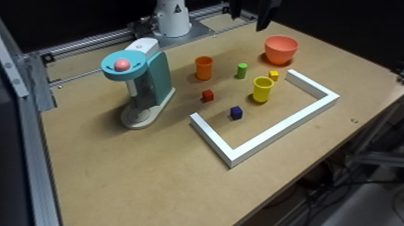
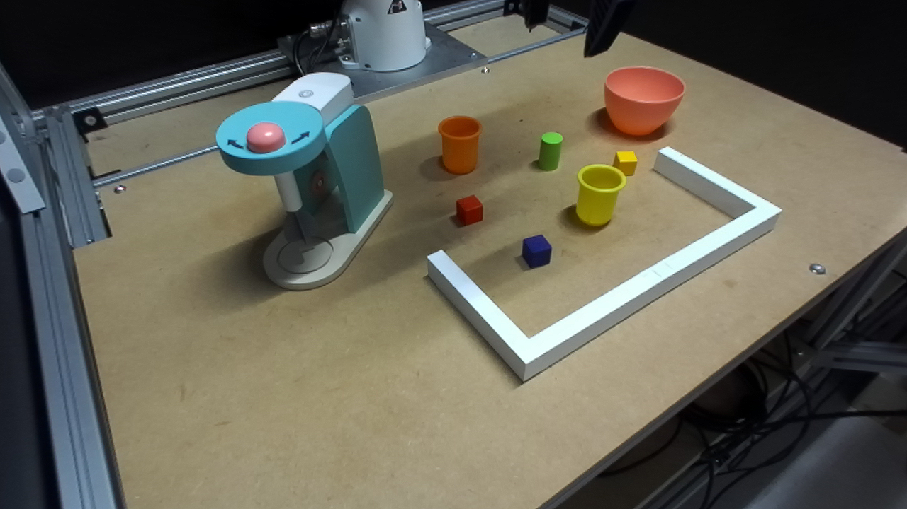
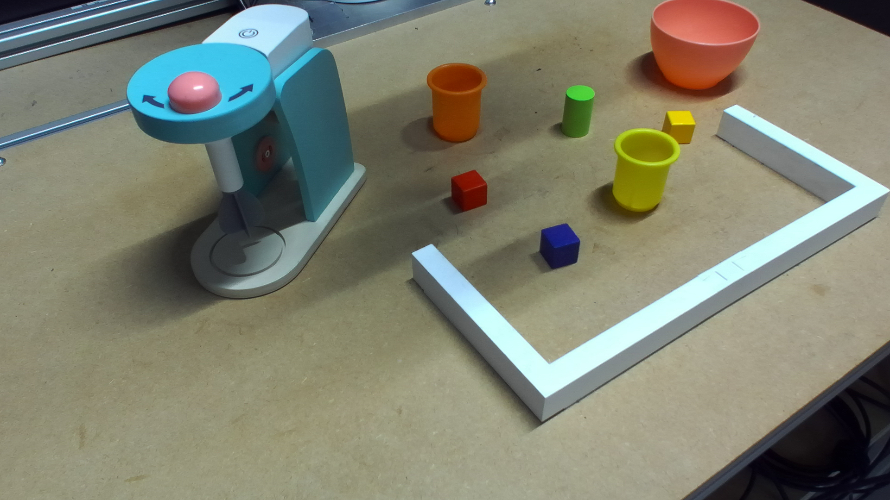
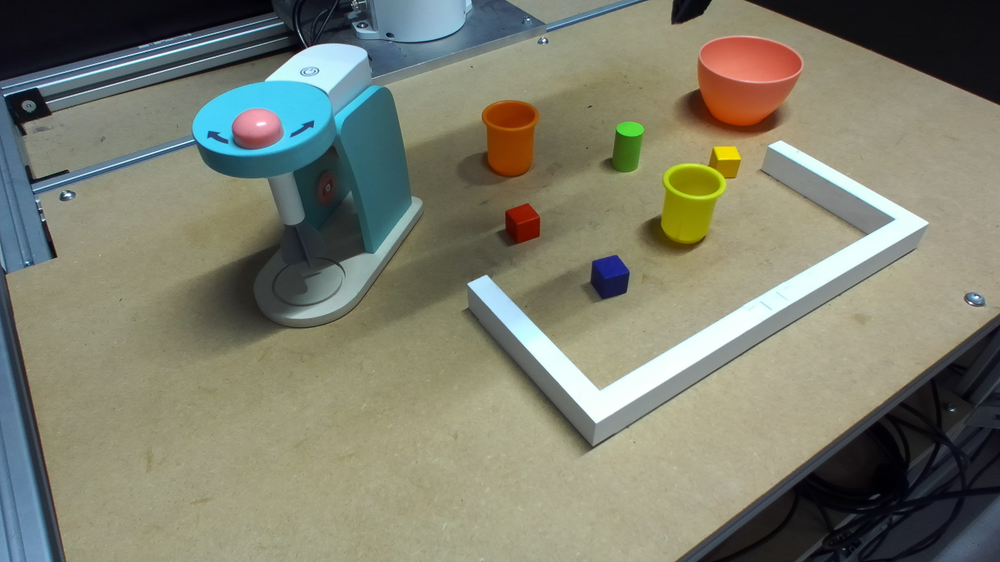

# Interactive RGB point-cloud samples

[Open the interactive 3D viewer](https://htmlpreview.github.io/?https://raw.githubusercontent.com/EnesUlasDincer/FFS_stream/zed-trt-pointcloud-streaming/streamer/pointcloud_samples/index.html)

The viewer loads the colored PLY samples directly from this repository, shows
the native-resolution rectified RGB reference captured with each 30k cloud,
and includes RGB XYZ axes. The 15k cloud is a separate capture of the same
scene. X is already reflected to match the verified real-world/legacy VR
convention.

| Capture mode | RGB reference | Point clouds |
|---|---|---|
| VGA | [](one_zed_vga_rgb.png) | [15k PLY](one_zed_vga_15000.ply) · [30k PLY](one_zed_vga_30000.ply) |
| HD720 | [](one_zed_hd720_rgb.png) | [15k PLY](one_zed_hd720_15000.ply) · [30k PLY](one_zed_hd720_30000.ply) |
| HD1080 | [](one_zed_hd1080_rgb.png) | [15k PLY](one_zed_hd1080_15000.ply) · [30k PLY](one_zed_hd1080_30000.ply) |
| HD2K | [](one_zed_hd2k_rgb.png) | [15k PLY](one_zed_hd2k_15000.ply) · [30k PLY](one_zed_hd2k_30000.ply) |

To run the viewer locally:

```bash
cd streamer/pointcloud_samples
python -m http.server 8000
```

Then open <http://127.0.0.1:8000>. The HTTP server is required because browsers
do not allow the ES module and PLY requests when `index.html` is opened directly
as a local file.
